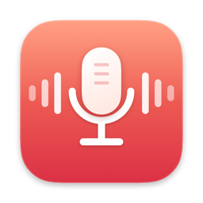
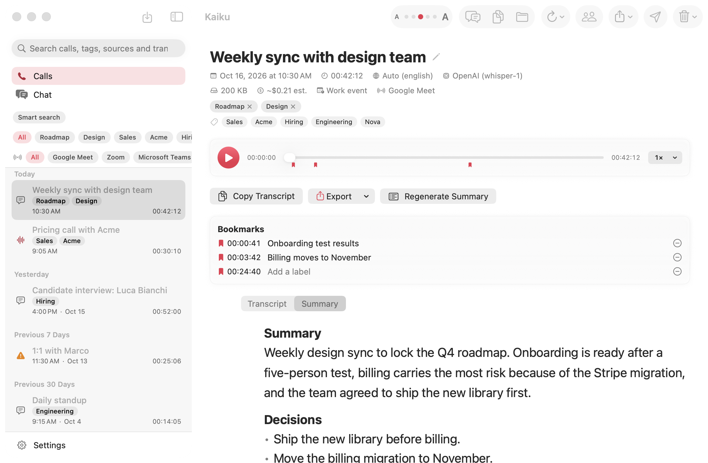
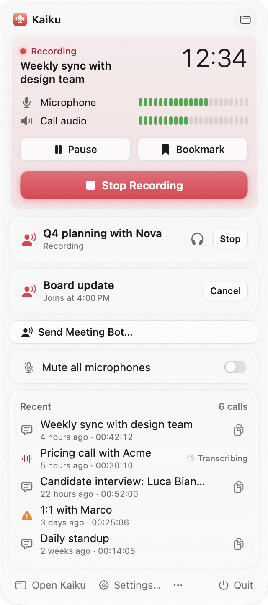

<div align="center">



# Kaiku

**Every call, recorded and transcribed on your Mac.<br>No bot, unless you send one. No subscription. Your files stay yours.**

<sub>*Kaiku* is Finnish for echo: what was said, played back when you need it.</sub>

[](#requirements)
[](Package.swift)
[](LICENSE)
[](https://github.com/gabry-ts/kaiku/releases/latest)

[**Download**](https://github.com/gabry-ts/kaiku/releases/latest) · [Website](https://apps.partiti.dev/#kaiku) · [Release notes](docs/release-notes)

<picture>
  <source media="(prefers-color-scheme: dark)" srcset="docs/images/library-summary-dark.png">
  
</picture>
<picture>
  <source media="(prefers-color-scheme: dark)" srcset="docs/images/panel-bot-dark.png">
  
</picture>

</div>

## Features

**Record.** Your microphone and the call audio go on separate tracks, with no virtual audio driver. Kaiku notices calls and can start recording by itself for the apps you choose, names them from your calendar, and stops the ones you forget. Pause, drop bookmarks, or Option-click the menu bar icon to mute every microphone on the Mac.

**Meeting bot.** Can't make it? Paste a Google Meet, Teams, Webex or FaceTime link, or pick one of today's meetings, and the bot joins now or when it starts. It runs in a hidden Chrome on your Mac, not in someone's cloud, with your name, picture and chat message, records the call and leaves when everyone else does. Put the headphones on to listen in.

**Transcribe.** Locally with whisper.cpp or the macOS 26 speech recognizer, or in the cloud with ElevenLabs, OpenAI, Groq or Alibaba Cloud and your own key. Your lines and the other side's are told apart, speakers get names from the calendar invite, and live transcription with Live Assist keeps a running summary while you talk. Silence is trimmed before cloud transcription, and each cloud transcription shows its estimated cost.

**Read and chat.** One window for calls, chat and settings. Search by text, tag, source or meaning, follow the transcript word by word as it plays, and ask your calls anything: answers cite the moment and jump to it. Summaries come with action items for Reminders, Things and Linear.

**Take it anywhere.** Export to Markdown, TXT, SRT, VTT and DOCX, send a webhook when a transcript is ready, import audio and video files, and dictate anywhere on the Mac (off until you turn it on). Recordings shorter than 30 seconds go to the Trash before anything is spent on them.

### Agents and automations

Kaiku's MCP server adds your calls to Claude Code, Codex and Claude Desktop in one click from Settings, and works while the app is closed. Reading is always allowed; editing calls and transcribing files each have their own switch.

| Tool | What it does |
| --- | --- |
| `list_calls`, `get_call` | List calls with filters, or get one call's details, speakers and bookmarks |
| `read_transcript`, `read_summary` | Read a transcript a page at a time, or the summary |
| `search_transcripts`, `semantic_search` | Find passages by their words, or by meaning |
| `rename_call`, `set_tags`, `rename_speaker` | Retitle a call, change its tags, name its speakers |
| `transcribe_again`, `summarize_again` | Have the app redo a transcript or summary |
| `transcribe_file`, `get_transcription` | Transcribe any audio or video file and get the text back, saved only on request |

**Raycast**: start, stop, pause, bookmark, mute, search calls and ask calls. **Shortcuts**: get the last call, find calls, get a transcript or summary, transcribe or summarize again, and control the recording. Calls also show up in **Spotlight**.

## Install

```sh
brew install --cask gabry-ts/tap/kaiku
```

Or download the latest `.dmg` from [Releases](https://github.com/gabry-ts/kaiku/releases/latest). Kaiku updates itself automatically after that.

## Requirements

macOS 14.2 or later, Apple Silicon or Intel; grants microphone, system audio and notification access on first recording (calendar and accessibility are optional). The meeting bot needs Google Chrome.

## Build from source

```sh
SIGN_IDENTITY=- ./scripts/build-app.sh   # build/Kaiku.app
open build/Kaiku.app
```

## Privacy

Everything is stored locally; audio leaves your Mac only with the cloud provider you pick, and not at all with whisper.cpp or the macOS speech recognizer.

## License

GNU General Public License v3.0. Copyright (C) 2026 Gabriele Partiti.
